# FULL TIME DRAMA — video formatı (üretim tarifi)

Bu dosya, FULL TIME DRAMA videolarının **aynısını** yapmak için yazıldı. Bir yapay zekâ asistanına (ör. Claude) bu dosyayı ve repodaki örnek videoları ver: "FORMAT.md'deki tarife birebir uyarak `<konu>` için bir FULL TIME DRAMA videosu yap" de. Ölçüler 1080×1920 kare içindir (px).

> Referans videolar: [Galatasaray 1-4 Barcelona (maç analizi)](https://github.com/tanisman441/fulltimedrama/releases/download/mac-02-galatasaray-barcelona/mac-02-galatasaray-barcelona.mp4) · [Lionel Messi (oyuncu hikâyesi)](https://github.com/tanisman441/fulltimedrama/releases/download/ftd-messi/ftd-messi.mp4). Üretmeye başlamadan önce ikisini de baştan sona izle.

<p>
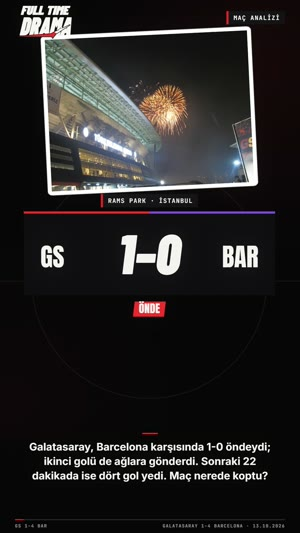 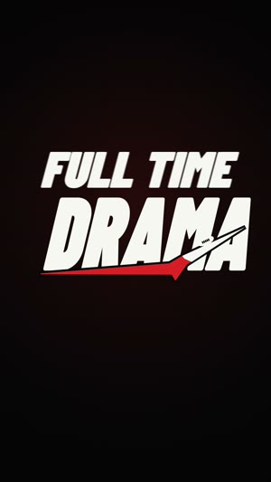 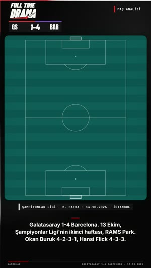 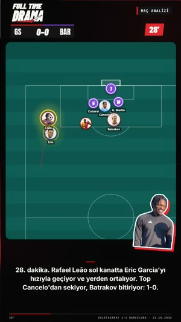 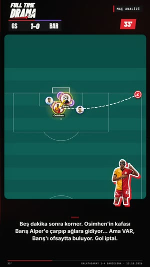 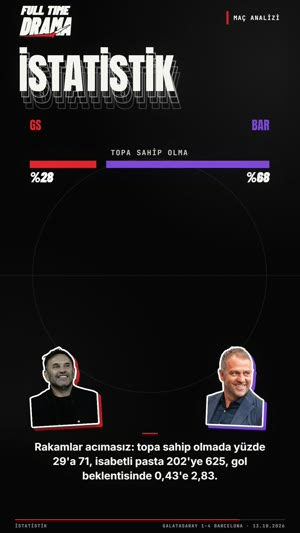<br>
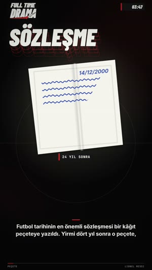 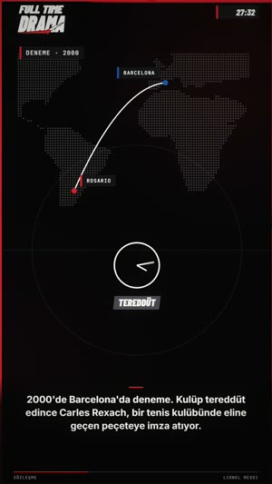 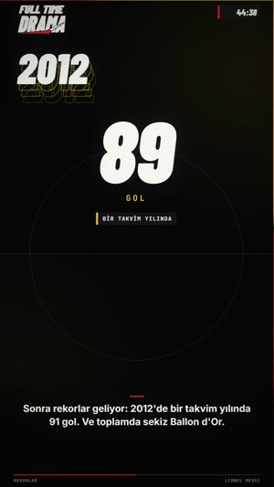 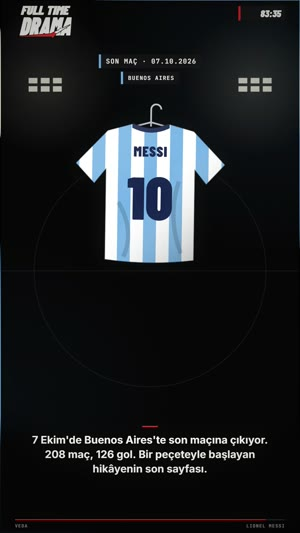 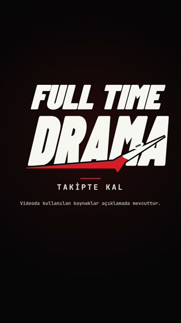
</p>

---

## 1. Teknik
| | |
|---|---|
| Boyut | 1080×1920 dikey, **60 fps**, H.264 (crf ~16), AAC 256k |
| Süre | **1:40–1:50** (asla 2:30'u geçme) — 12–13 seslendirme satırı |
| Ses | ≈ **−14 LUFS**, gerçek tepe ≤ −1 dBFS |
| Görüntü | **Tamamen kodla çizilmiş animasyon** (Canvas/JS, Remotion, After Effects vb.) — maç görüntüsü / yayın kaydı KULLANMA (telif). Hareket bulanıklığı hafif. |
| Fotoğraf | Oyuncu/teknik direktör/stadyum fotoğrafları sadece lisanslı kaynaktan (Wikimedia Commons: CC0, CC BY, CC BY-SA); yazar künyeleri açıklamaya |

## 2. Renk + yazı
| Öğe | Değer |
|---|---|
| Zemin | saf siyah `#050506`, merkezde çok hafif kırmızı sis (`#D61C26`, %5–15 opaklık) + kenar vinyeti (%50 siyah) |
| Ana renk (logo kırmızısı) | `#D61C26` — geçişler, çizgiler, saat kutusunun şeridi, altyazı üst çizgisi, ilerleme çubuğu |
| Yazı beyazı | `#F6F6F2` (gövde `#F4F4F0`), soluk `#969692` |
| Başlık / rakam fontu | **Barlow Condensed 900 italik** (logonun yazı tipi) — büyük başlıklarda arkada 3 kademeli kontur "eko" kopyası (aşağı-sağa kayık, vurgu renginde, giderek soluk) |
| Etiket/çip fontu | **JetBrains Mono 700**, BÜYÜK harf, harf aralığı geniş (2–6 px) |
| Altyazı fontu | **Inter 700**, 38 px, beyaz, hafif siyah gölge |
| Takım renkleri | her bölümde TEK vurgu rengi: kulüp renkleri (ör. Galatasaray `#E1232D`, Barcelona `#7D46D7`, Arjantin göğü `#75AADB`) |

## 3. Logo
- İki satır: **FULL TIME** (üstte, daha küçük) / **DRAMA** (büyük); beyaz, Barlow Condensed 900 italik, sola eğik (≈ −8°), harfler kalın. DRAMA'nın altından **kırmızı bir mızrak/kama** çıkar, sağa doğru incelip A harfinin içinden yukarı kıvrılarak sivri uçla biter; mızrağın ucunda küçük beyaz **bağcıklı top**. Mızrağın kenarında siyah boşluk (harfi "keser"). Referans: [gorseller/logo_kart.jpg](gorseller/logo_kart.jpg).
- Videonun içinde sol üstte küçük logo (≈200 px genişlik, merkezi x≈154, y≈80).

## 4. Akış (zaman çizelgesi)
```
0:00  HOOK (6–9 sn)           dramatik soru/olay + ilk görsel; müzik sadece gerilim pedi
      FTD GİRİŞ (2,7 sn)      logo animasyonu (aşağıda)
      BÖLÜMLER (≈7 sn/satır)  her seslendirme satırı ≈ bir bölüm; kırmızı mızrak geçişleriyle
      SON SATIR               "Yani…" özet + duygusal/ileriye dönük kapanış
~1:35 FTD KAPANIŞ (5,6 sn)    logo + TAKİPTE KAL + kaynak notu
```
- **Giriş animasyonu (2,7 sn):** siyah ekranın ortasında gri kutu (600×220, üst kenarında 10 px kırmızı şerit) içinde maç saati **89:58 → 89:59 → 90:00** (Barlow italik 190 px) → 0,62 sn: düdük sesi, saat **FT** olur → 0,72 sn: kırmızı mızrak soldan sağa çizilerek girer, ekranda anlık kırmızı flaş (%35) → 0,98 sn: **DRAMA** harfleri tek tek büyükten küçüğe çarparak oturur (ekran kısa sarsılır) → 1,22 sn: **FULL TIME** soldan kayarak gelir → 1,75 sn: logoda parlama. Logo ekran genişliğinin %82'si, dikeyde ekranın %40–45'inde.
- **Kapanış (5,6 sn):** aynı animasyon + 2,1 sn'de logonun altında kısa kırmızı çizgi ve harf harf yazılan **TAKİPTE KAL** (JetBrains Mono 44 px, geniş aralık) + 2,8 sn'de altında soluk **"Videoda kullanılan kaynaklar açıklamada mevcuttur."** → son 0,4 sn siyaha kararır.
- **Geçiş (her bölüm başı, 0,28 sn):** ekranı ≈ −29° eğik bir **kırmızı mızrak bandı** soldan sağa süpürür (önde sivri uç, arkasında ince siyah çizgi); bölüm değişimi bu bandın arkasında olur.

## 5. Sabit ekran öğeleri (giriş/kapanış hariç her karede)
- **Sol üst:** küçük FTD logosu.
- **Sağ üst — maç saati:** koyu kutu (168×52, solunda 8 px kırmızı şerit), Barlow italik 36 px; video boyunca **00:00 → 90:00** akar (videonun ilerlemesiyle orantılı). Maç analizinde: logonun altında skor şeridi (**GS 0-0 BAR**, olay oldukça güncellenir) ve sağda kırmızı kutuda maçın o anki dakikası (**28'**), sağ üstte "MAÇ ANALİZİ" etiketi.
- **Alt bant:** 4 px ilerleme çubuğu (y≈1870; soluk beyaz zemin, dolan kısım kırmızı); altında solda bölüm adı (mono 16 px, ör. "28'", "İSTATİSTİK"), sağda konu ("GALATASARAY 1-4 BARCELONA · 13.10.2026", "LIONEL MESSI").
- **Altyazı:** y≈1650 merkezli, en fazla 3 satır (satır ≤ 900 px), üstünde 56×5 px kırmızı çizgi; alt 420 px siyaha kararan degrade üstünde. Uzun cümle 2'şer satırlık parçalar hâlinde, seslendirmeyle senkron.
- İçerik alanı y=250–1450 (altyazıya ve üst logoya taşmaz). Ekran sürekli hareketli: çok hafif nefes alan zoom (±%1) ve 4 px gezinme.

## 6. Bölüm görselleri (çizim dili)
**Ortak:** her bölümde bir **büyük başlık** (Barlow italik + eko, ör. "SÖZLEŞME", "İSTATİSTİK", "2012") veya bir **çip** (koyu kutu + solda renkli şerit + mono yazı, ör. "DENEME · 2000", "SON MAÇ · 07.10.2026"), ortada **tek bir ana görsel**, kelimeyle senkron gelen küçük etiketler. Her şey seslendirmedeki ilgili kelimede belirir (sayılar sayarak artar, çizgiler çizilerek uzar).

**Maç analizi kiti**
- **Taktik tahtası:** yuvarlak köşeli panel (x 30, y 250, 1020×1180), koyu deniz yeşili `#0A4A44` + biçme şeritleri (`#0C524B` / `#0E5A52`, her 5,25 m), beyaz yarı saydam saha çizgileri; dikey, hücum **yukarı**. Kamera tahtada yakınlaşıp kayar (gol anında ceza sahasına zoom).
- **Oyuncular:** takım renginde halkalı **yuvarlak fotoğraf rozetleri** (lisanslı fotoğraf) ya da forma numaralı diskler; altlarında küçük isim. Konumlar maç özetinden **saniye saniye okunur** (hangi dakika/saniye aralığından okunduğunu not al).
- **Hareket:** pas = beyaz düz ok, koşu = kesikli çizgi, şut = kırmızı kesikli çizgi + kaleye giren top; top çizgi boyunca kayar. Hata anında oyuncunun etrafında kırmızı nabız halkası. Golü atan oyuncunun büyük fotoğrafı köşeden kayarak girer.
- **Kimlik bölümü:** iki dizilişin (ör. 4-2-3-1 / 4-3-3) tahtada yerleşmesi + alt çip "ŞAMPİYONLAR LİGİ · 2. HAFTA · 13.10.2026 · İSTANBUL".
- **VAR / iptal:** ofsayt çizgisi + kırmızı çarpı, skor şeridi geri döner.
- **İstatistik:** iki takım rengi karşılıklı yatay çubuklar (topa sahip olma %, isabetli pas, xG), rakamlar sayarak; altta iki teknik direktörün fotoğrafı.

**Oyuncu hikâyesi kiti (fotoğrafsız da olur)**
- Oyuncu **sırttan çizilmiş forma** ile anlatılır (kulübe göre forma rengi + isim + numara); askıda forma = veda.
- Kırılma anları için nesneler: belge/peçete (tarihli), noktalı dünya haritası üzerinde uçuş yayı (şehir pinleri), saha/kale çizimi, dev sayaç (89 → 91 gol), skor tabelası, saat ("tereddüt").
- Hikâye **kulüp turu değil**: hayatını değiştiren anlar + az bilinen gerçekler + neden efsane.

## 7. Senaryo
- **Yapı:** HOOK (dramatik an/soru, 1–2 cümle) → bağlam (tarih, yer, kim) → 8–10 olay satırı (her biri bir bölüm) → "Yani …" özet + kapanış cümlesi.
- **Dil:** kısa, sinematik, şimdiki zaman ("28. dakika. Leão sol kanatta Eric'i geçiyor…"). Her rakam, tarih, isim **kaynaklı**; uydurma yok. Yorum dilenme yok ("yorumlara yaz" gibi kapanış KULLANMA).
- **Uzunluk:** 12–13 satır, satır başına ~15–25 kelime, toplam ≈ 230–260 kelime.
- **Örnek hook'lar:** "Galatasaray, Barcelona karşısında 1-0 öndeydi; ikinci golü de ağlara gönderdi. Sonraki 22 dakikada ise dört gol yedi. Maç nerede koptu?" · "Futbol tarihinin en önemli sözleşmesi bir kâğıt peçeteye yazıldı."

## 8. Ses
- **Seslendirme:** Gemini TTS (`gemini-3.8-flash-tts` veya en yeni TTS modeli), tok erkek sesi (ör. Orus, Charon, Algenib, Fenrir — birkaçını dinleyip en tok olanı seç; kanalda hep aynı ses). Prompt:
  ```
  # AUDIO PROFILE: Türk futbol dram anlatıcısı
  Tok, etkileyici ve kendinden emin bir erkek sesi; futbolun en dramatik hikâyelerini kısa videolarla anlatan, gerçek bir insan gibi konuşan bir içerik üreticisi.

  ### DIRECTOR'S NOTES
  Style: Sinematik ve gerilimli bir belgesel anlatımı; her cümlede hafif bir merak ve gerilim. Yılları, rakamları ve isimleri net söyle. Kayıp ve kâbus anlarında ses ağırlaşsın, zafer anlarında enerji yükselsin. Son cümlede sakin, duygulu bir kapanış. Robotik değil, doğal.
  Pacing: Hızlı Reels temposu, cümle içinde gereksiz duraksama yok. Virgüllerde kısa, noktalarda doğal duraksamalar. Her paragraf bittiğinde yaklaşık bir saniye sessizlik bırak.
  Accent: Doğal İstanbul Türkçesi.

  Sadece TRANSCRIPT bölümündeki metni seslendir; bu notları okuma.

  #### TRANSCRIPT
  <satırlar, aralarında boş satır>
  ```
  Sayıları yazıyla ver ("yüzde yirmi dokuz", "iki bin yirmi altı"). Hedef hız ≈ 2,7 kelime/sn (gerekirse hafif hızlandır). Satır aralarında ~0,15 sn boşluk.
- **Müzik:** dramatik yatak — oyuncu hikâyesi 100 BPM, Re minör (Dm–Bb–F–C): alçak tomlar, nabız bas, yaylı ped, pluck; maç analizi 112 BPM sürükleyici (Am–F–C–G). Hook'ta sadece gerilim dronu.
- **Efektler:** girişte saat tıkırtısı + **düdük** + mızrak "whoosh"u + DRAMA'da çarpma; her geçişte mızrak whoosh'u; hook'ta konuya göre (stadyum uğultusu, kalem cızırtısı, tokmak); kelimelere senkron küçük vuruşlar (gol = file/çarpma, VAR = elektronik bip, sayaç = tık tık).
- Seslendirme müzikten belirgin yüksek (konuşmada müzik kısılır).

## 9. Açıklama (her video)
1. merak uyandıran ilk satır (+1–2 emoji) 2. 2–3 cümle özet 3. "Daha fazla futbol dramı için takip et." / "Yeni maç analizleri için takip et." 4. **Kaynaklar:** her bilgi için site adı + URL 5. fotoğraf künyeleri 6. 6–8 hashtag, **#fulltimedrama** dahil. Örnekler: [videolar/](videolar/).

## 10. Teslim öncesi kontrol
- [ ] Süre 1:40–1:50, 1080×1920, 60 fps, ses −14 LUFS / tepe ≤ −1 dBFS
- [ ] Giriş: 89:58 → 90:00 → FT → mızrak → DRAMA → FULL TIME; kapanışta TAKİPTE KAL + kaynak notu
- [ ] Her bölüm geçişi kırmızı mızrak; sol üst logo, sağ üst saat, alt ilerleme çubuğu + bölüm adı
- [ ] Altyazı seslendirmeyle senkron, taşma yok, Türkçe karakterler (İ, ş, ğ) kırpılmıyor
- [ ] Her rakam/tarih kaynaklı; maç analizinde konumlar maç özetinden okunmuş
- [ ] Hiçbir yayın görüntüsü / lisanssız fotoğraf yok; fotoğraf künyeleri açıklamada
- [ ] Hiçbir kare boş değil, her an bir şey hareket ediyor
