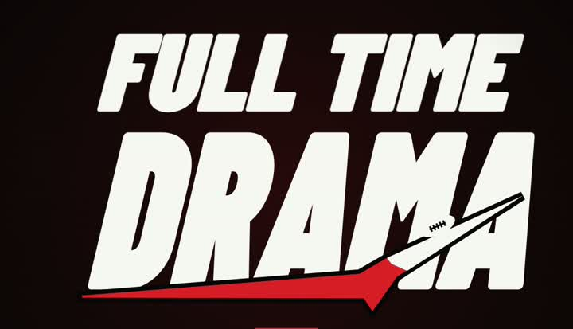
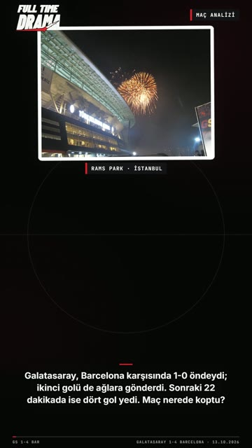
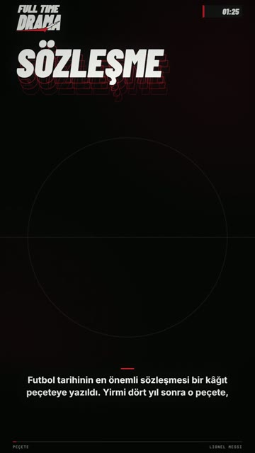
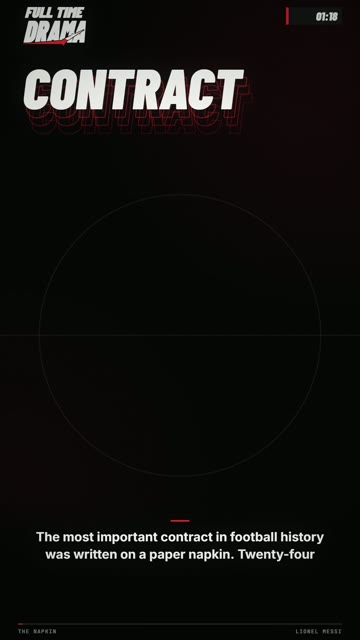

# FULL TIME DRAMA — videolar

FULL TIME DRAMA kanalı için hazırlanan, paylaşıma hazır dikey videolar (1080×1920, Instagram Reels / TikTok / Shorts).
Her videonun **indirme linki** ve **paylaşım açıklaması** (kaynaklar + hashtag'ler) aşağıda.

| | Video | Dil | Süre | İndir | Açıklama |
|---|---|---|---|---|---|
|  | **Maç analizi: Galatasaray 1-4 Barcelona** (13 Ekim 2026, Şampiyonlar Ligi) | TR | 1:42 | [mp4 (41 MB)](https://github.com/tanisman441/fulltimedrama/releases/download/mac-02-galatasaray-barcelona/mac-02-galatasaray-barcelona.mp4) | [metin](videolar/mac-02-galatasaray-barcelona.md) |
|  | **Lionel Messi — peçeteden son finale** | TR | 1:40 | [mp4 (41 MB)](https://github.com/tanisman441/fulltimedrama/releases/download/ftd-messi/ftd-messi.mp4) | [metin](videolar/ftd-messi.md) |
|  | **Lionel Messi — from a napkin to the last final** | EN | 1:49 | [mp4 (43 MB)](https://github.com/tanisman441/fulltimedrama/releases/download/ftd-messi-en/ftd-messi-en.mp4) | [text](videolar/ftd-messi-en.md) |

Tüm dosyalar: [Releases](https://github.com/tanisman441/fulltimedrama/releases) · Format notu: [FORMAT.md](FORMAT.md)

## Nasıl kullanılır
1. Tablodaki **mp4** linkine tıkla → video iner (GitHub hesabı gerekmez).
2. **metin** linkindeki açıklamayı kopyalayıp paylaşımın açıklamasına yapıştır (kaynaklar ve hashtag'ler hazır).
3. Videonun sonunda FULL TIME DRAMA kapanış kartı ve "kaynaklar açıklamada" notu var; açıklamayı kaynaklarla birlikte paylaş.

## Notlar
- Videolar tamamen kodla çizilmiş animasyonlardır (ft-motion); seslendirme Gemini TTS. Maç analizinde oyuncu konumları maç özetindeki görüntülerden alındı; oyuncu fotoğrafları Wikimedia Commons'tan (künyeler açıklamada).
- Yeni videolar eklendikçe bu tablo güncellenir.
